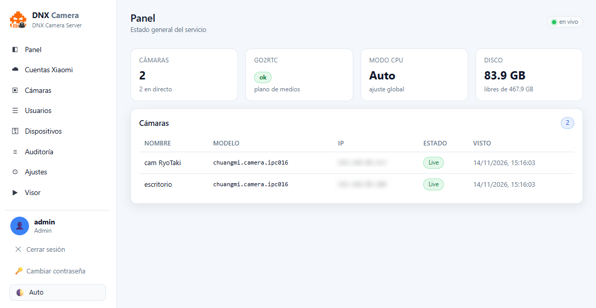
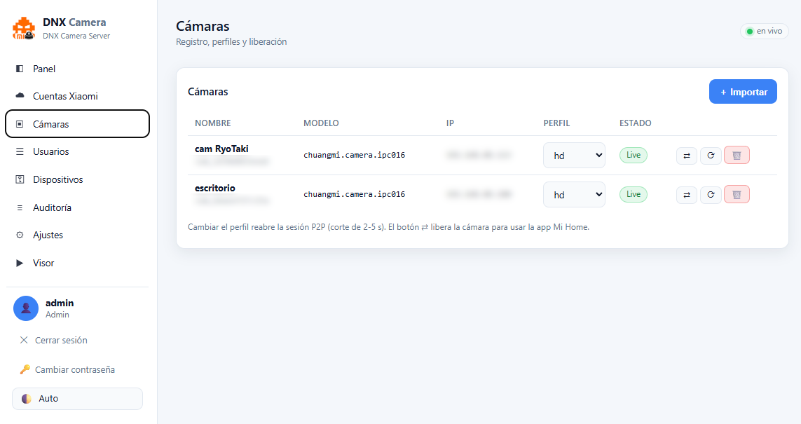
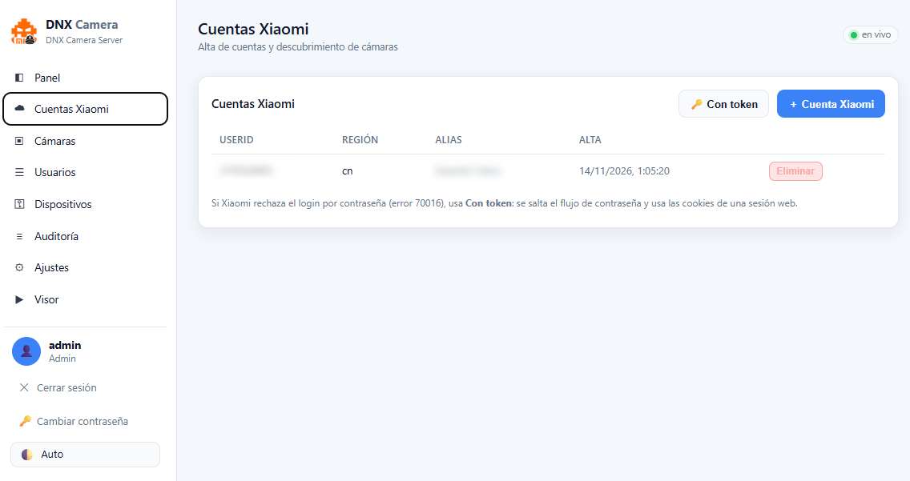
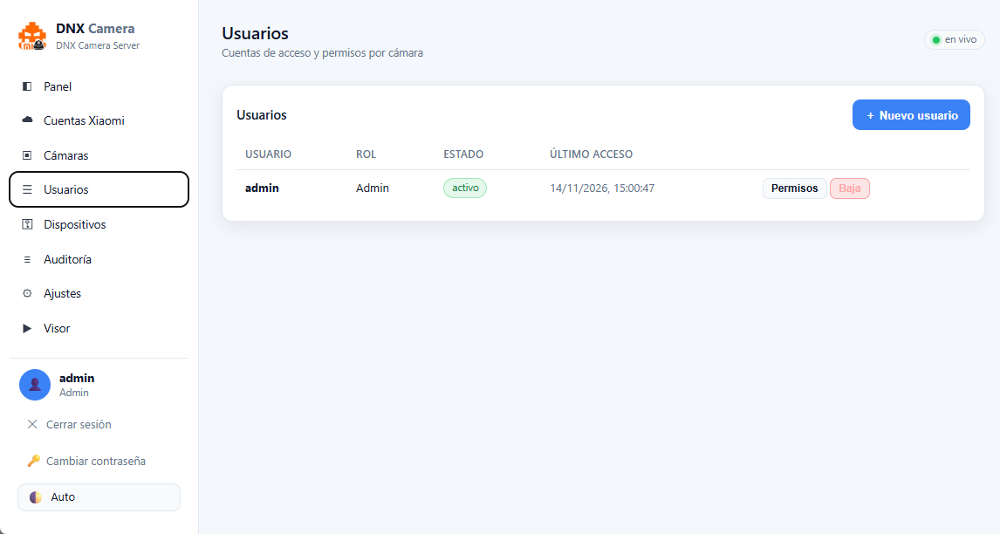
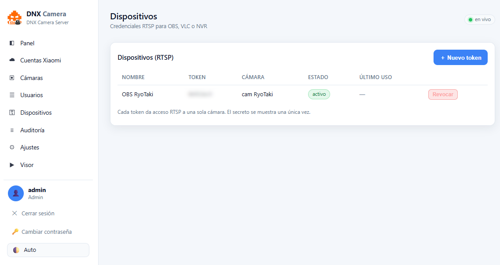
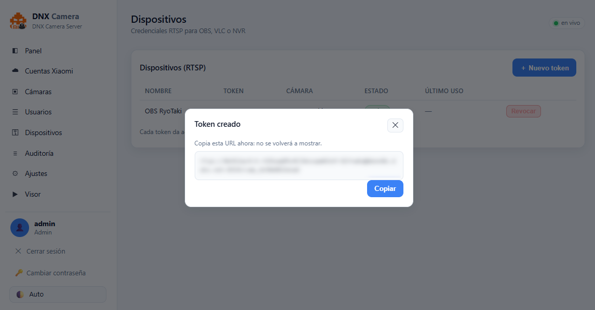
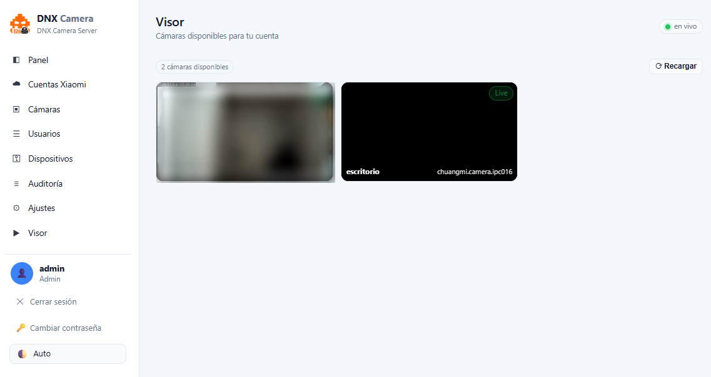
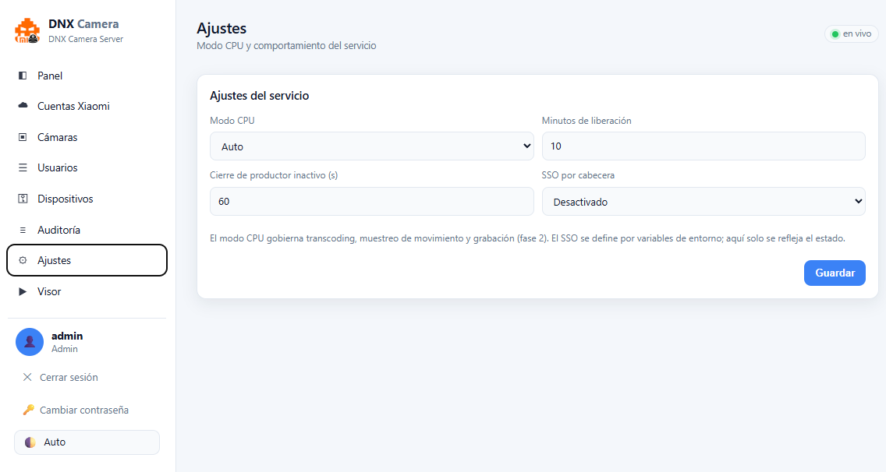
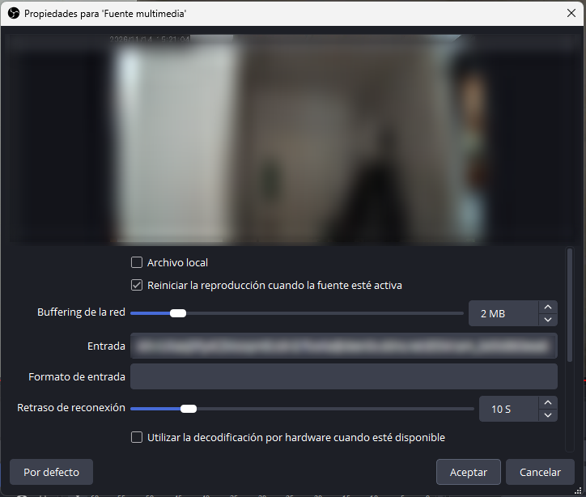

# DNX Camera Server

[](LICENSE)


-lightgrey)

Servidor autoalojado para **cámaras Xiaomi Mi Home** en red local. Conecta cuentas
Xiaomi, publica sus cámaras como streams y las ofrece a navegadores, OBS, VLC o
cualquier cliente RTSP de la LAN.

> **Alcance:** LAN únicamente. No se expone a Internet y no se hace ingeniería
> inversa de funciones que go2rtc no implemente (PTZ, zoom óptico, eventos nativos).

## Qué hace

- **Login Xiaomi** con contraseña, verificación 2FA y captcha (varias cuentas y regiones).
- **Catálogo de cámaras** con capacidades reales por modelo.
- **Visor web** con rejilla multicámara, pantalla completa, audio, snapshot y zoom
  digital en cliente.
- **Consola de administración**: cuentas, cámaras, usuarios, permisos, tokens de
  dispositivo, auditoría y ajustes.
- **Exportación RTSP autenticada** por dispositivo (`rtsp://.../cam_xxx`), con
  credenciales revocables y ACL por cámara.
- **Liberación temporal** de una cámara para poder usar la app Mi Home.
- **Modo CPU global** (`Lite` / `Auto` / `Calidad`).

## Capturas

> Capturas reales del servicio. Las direcciones IP, el identificador de cuenta y el
> contenido de vídeo están difuminados.

### Consola de administración

| Panel | Cámaras |
|---|---|
|  |  |
| Estado del servicio, modo CPU, disco y cámaras en vivo. | Perfil HD/SD, liberación para Mi Home y reconexión. |

| Cuentas Xiaomi | Usuarios |
|---|---|
|  |  |
| Alta con contraseña o con `passToken` cuando Xiaomi bloquea el login (70016). | Permisos por cámara: ver, oír y hablar. |

| Dispositivos | Token recién creado |
|---|---|
|  |  |
| Un token por cámara, revocable al instante y con registro de uso. | La URL RTSP con credenciales se muestra una sola vez. |

### Visor y ajustes

| Visor | Ajustes |
|---|---|
|  |  |
| Rejilla multicámara; clic para pantalla completa, audio y zoom digital. | Modo CPU global, ventana de liberación y cierre por inactividad. |

### Integración con OBS



*OBS → Fuente multimedia apuntando a la URL RTSP del token de dispositivo.*

## Arquitectura

Documentación completa en [`Project_Architecture.md`](Project_Architecture.md)
(17 ADR) y plan de ejecución en [`IMPLEMENTATION_PLAN.md`](IMPLEMENTATION_PLAN.md).

```
Navegador / OBS / VLC
        │ HTTPS · RTSP
┌───────▼──────────────────────────────────────────┐
│ DNXCameraServer (.NET 10)                        │
│  API · UI · gateway RTSP · auditoría · workers   │
└───────┬──────────────────────────────────────────┘
        │ 127.0.0.1 (API/RTSP interno)
┌───────▼──────────────────────────────────────────┐
│ go2rtc 1.9.15 (sidecar, MIT)                     │
│  P2P TUTK/CS2 · códecs · WebRTC · snapshot       │
└───────┬──────────────────────────────────────────┘
        │ UDP P2P (LAN) + HTTPS a *.mi.com (claves)
   Cámaras Xiaomi
```

## Inicio rápido

```bash
git clone <repo> && cd DNXCameraServer
mkdir -p data recordings
docker compose up -d --build
```

Después:

1. Abre `http://<ip-del-host>:8090`.
2. **Instalación inicial**: la web pide crear el administrador (usuario y contraseña).
   No hay contraseñas por defecto.
3. **Cuentas Xiaomi → Añadir cuenta** (usuario, contraseña, 2FA/captcha).
4. **Cámaras → Importar**: elige la cuenta, carga dispositivos e importa.
5. **Visor**: rejilla y pantalla completa.
6. **Dispositivos**: crea un token y copia la URL RTSP para OBS/VLC.

> ¿Olvidaste la contraseña de administrador? Ejecuta el servicio con
> `--reset-admin-password`: elimina los administradores y la web vuelve a pedir
> crear uno. Ver [`docs/DEPLOY.md`](docs/DEPLOY.md#resetear-el-administrador).

## Puertos

| Puerto | Uso |
|---|---|
| 8090/tcp | UI y API (TLS lo aporta tu reverse proxy, si lo hay) |
| 8554/tcp | RTSP autenticado por dispositivo |
| 8555/udp+tcp | WebRTC (media) |
| 1984/tcp | API de go2rtc — **solo loopback** |
| 18554/tcp | RTSP interno de go2rtc — **solo loopback** |

`network_mode: host` es obligatorio (P2P UDP, broadcast de CS2 y candidatos ICE).

## Requisitos y límites

- Host **Linux** con Docker (amd64/arm64). Docker Desktop en Windows/macOS **no**
  es un objetivo soportado.
- El servidor debe estar en la **misma LAN** que las cámaras.
- Internet es necesario para el handshake de claves en cada conexión.
- Compatibilidad por modelo: la lista viva la mantiene go2rtc
  ([issue #1982](https://github.com/AlexxIT/go2rtc/issues/1982)). Los modelos no
  soportados se muestran como tales, sin fallar en silencio.
- **Audio bidireccional** (hablar a la cámara) requiere contexto seguro: HTTPS de
  confianza o `localhost`. Sin él, la función se deshabilita con un aviso.

## Documentación

- [`docs/DEPLOY.md`](docs/DEPLOY.md) — despliegue, firewall, actualización, respaldo.
- [`docs/OBS.md`](docs/OBS.md) — usar las cámaras en OBS.
- [`docs/DEV.md`](docs/DEV.md) — desarrollo local y pruebas.
- [`docs/TROUBLESHOOTING.md`](docs/TROUBLESHOOTING.md) — error 70016 de Xiaomi, alta con token y diagnóstico.

## Licencia y créditos

Proyecto distribuido bajo **licencia MIT** — ver [`LICENSE`](LICENSE).

El plano de medios es [go2rtc](https://github.com/AlexxIT/go2rtc) (MIT), usado como
binario sin modificar y fijado por versión y checksum. Atribuciones completas en
[`THIRD_PARTY_NOTICES.md`](THIRD_PARTY_NOTICES.md).

## Contribuir y seguridad

- [`CONTRIBUTING.md`](CONTRIBUTING.md) — cómo compilar, probar y abrir un PR.
- [`SECURITY.md`](SECURITY.md) — modelo de seguridad y reporte privado de vulnerabilidades.
